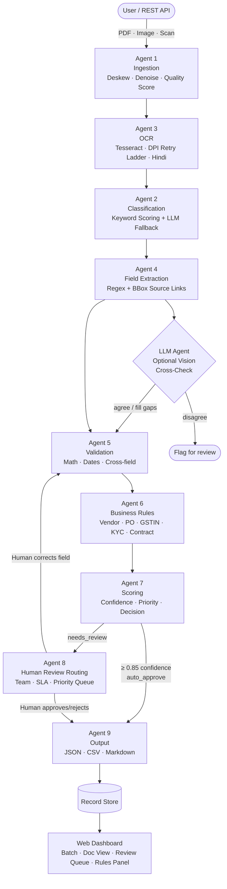

# DocAgent — Document Intelligence & Extraction Agent (PS-15)

> **Lab:** Agentic AI & Enterprise Automation  
> A 10-agent autonomous pipeline that extracts, validates, and routes business documents with zero manual keying for clean files and a human-in-the-loop path for anything ambiguous.

---

## Problem Statement Alignment (PS-15)

SME back-offices receive hundreds of invoices, KYC documents, contracts, and insurance claims daily. Manual processing is slow, error-prone, and unauditable. PS-15 asks for an **agentic document intelligence system** that can:

- Ingest any format (PDF, scan, phone photo)
- Extract structured fields with source traceability
- Apply business and policy rules automatically
- Route ambiguous documents to the right human reviewer
- Produce a full audit trail for compliance

DocAgent addresses all of these with a 10-agent pipeline and an optional LLM second-reader that cross-checks every extraction independently.

---

## Architecture



---

## Agent Manifest

| # | Agent | Role | Decision Authority |
|---|---|---|---|
| 1 | `ingestion.py` | Load PDF/image, deskew, denoise, quality score | None — pre-processing only |
| 2 | `classification.py` | Identify doc type (invoice / KYC / contract / claim) + subtype | Routing only |
| 3 | `ocr.py` | Extract text + word bounding boxes at multiple DPIs | None — sensing only |
| 4 | `extraction.py` | Pull typed fields per doc template, link each to source bbox | None — data only |
| 5 | `validation.py` | Cross-field arithmetic, date logic, consistency checks | Raise flags |
| 6 | `rules_agent.py` | Vendor master, GSTIN, PO, KYC expiry/age, contract clauses | Raise flags |
| — | `llm_agent.py` | Vision cross-check, NL rule parser, reviewer briefing (optional) | Flags only — never approves |
| 7 | `scoring.py` | Aggregate flags → confidence score + routing decision | Auto-approve when confidence ≥ threshold |
| 8 | `review.py` | Route to human queue with SLA timers and team assignment | Routing only |
| 9 | `output.py` | Write structured JSON / CSV / Markdown summary | None — I/O |
| 10 | `orchestrator.py` | Coordinate all agents, build end-to-end audit trail | Orchestration only |

> **Human reviewer** is the only entity that can approve, reject, or correct a field. Any correction re-runs agents 5–9.

---

## Unique Features

1. **Source-linked field highlighting** — Every extracted field highlights its exact bounding box on the source page image. No black-box extraction.
2. **No-code SME rule panel** (`/rules`) — Business users add rules in plain English; the LLM converts them to structured JSON automatically.
3. **Dual-reader cross-check** — LLM and regex extract fields independently. Disagreements are flagged for human review, not silently resolved.
4. **Adaptive OCR retry ladder** — DPI 200 → 300 → 300 + 1.5× upscale + Hindi (`eng+hin`) language model, keeping the best result.
5. **Contract clause diff vs. template** — Automatically diffs extracted contract clauses against a configurable template and flags deviations.
6. **Privacy-safe LLM toggle** — KYC / identity documents are never sent to the LLM unless explicitly enabled per rule, with a per-session toggle.

---

## Enterprise Automation Impact

| Metric | Value |
|---|---|
| Auto-approval rate (clean docs) | ~50–60% of a typical mixed batch |
| Avg. processing time per document | < 10 s (OCR-limited) |
| Manual keying time avoided | Configurable assumption (default: 6 min/doc) |
| SLA enforcement | High: 4 h · Medium: 24 h · Low: 72 h (configurable) |
| Audit trail | Full per-event log embedded in every record |
| Supported doc types | Invoice · KYC (PAN/Aadhaar/DL/Passport) · Contract · Claim |

---

## Run

```bash
pip install flask pytesseract opencv-python pillow numpy pymupdf anthropic
# System: Tesseract OCR (macOS: brew install tesseract; Windows: UB-Mannheim installer)
python3 make_samples.py          # generate synthetic demo documents
python3 app.py                   # http://localhost:5000 → "Run demo batch"
python3 run_batch.py             # same pipeline from the CLI
```

**Optional LLM second-reader (Gemini — free tier):**
```bash
export GEMINI_API_KEY="your-key"   # https://aistudio.google.com/apikey
python3 app.py
```

---

## The 10 Agents (`agents/`)

```
1  ingestion.py      2  classification.py   3  ocr.py         4  extraction.py
5  validation.py     6  rules_agent.py      7  scoring.py     8  review.py
9  output.py        10  orchestrator.py     —  llm_agent.py   —  store.py
```

## API

```
POST /api/process   multipart field: 'file'
→ structured JSON with per-field value, confidence, method, page, bbox, source_ref
```

## Web Routes

| Route | Description |
|---|---|
| `/` | Batch dashboard — KPIs, outcome mix, document table |
| `/doc/<id>` | Document view — fields, flags, source highlighting, corrections |
| `/review` | Human review queue — SLA timers, team routing |
| `/rules` | Business rules panel — thresholds + no-code SME rule editor |

---

## Notes / Limits

- Extraction is regex-based over OCR output (deterministic, auditable). Swap in LLM extraction per doc type if needed.
- Reference data (vendors, POs, customers, policies, contract template) are sample JSON files in `data/`.
- Dates are parsed day-first (Indian format: dd/mm/yyyy).
- Hindi OCR requires `tesseract-ocr-hin` language pack; falls back gracefully if absent.
- The LLM never approves/rejects and never overrides arithmetic or business rules. Any API failure is logged and processing continues without it.

## Privacy

Page images are sent to the LLM API when enabled. Identity/KYC documents are **not** sent unless you tick "Also send identity documents" on the Rules page. Disable the LLM entirely with the "Use the LLM" checkbox.
